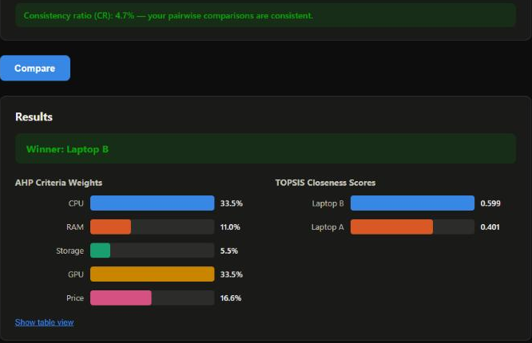
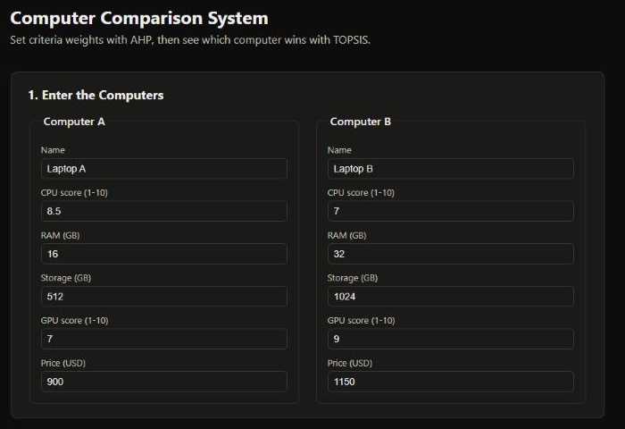
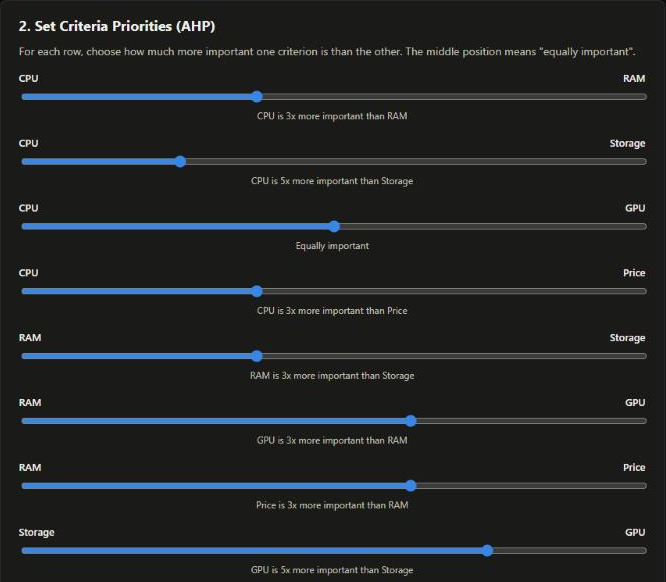
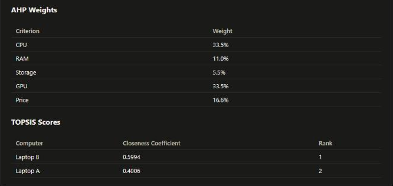

# JavaQerar — AHP & TOPSIS Decision Support System

A multi-criteria decision support system built with **Java 17** and **Spring Boot**. It helps you choose between two computers by combining two classic MCDM (Multi-Criteria Decision Making) methods:

- **AHP (Analytic Hierarchy Process)** works out how important each criterion is, based on the user's pairwise comparisons.
- **TOPSIS (Technique for Order Preference by Similarity to Ideal Solution)** ranks the alternatives by how close they are to the ideal solution, using the AHP weights.



---

## Features

- AHP and TOPSIS implemented from scratch in plain Java, with no external math libraries
- Consistency check (CR) that flags contradictory pairwise comparisons
- Single REST endpoint that returns weights, scores, ranks and the winner
- Web UI with sliders based on the Saaty 1–9 scale, bar charts and a table view
- Input validation with Jakarta Validation and centralized error handling

## How it works

```
User input (2 computers + 10 slider comparisons)
        │
        ▼
   AHP  ──►  criteria weights + consistency ratio (CR)
        │
        ▼
 TOPSIS ──►  closeness coefficient for each computer
        │
        ▼
   Ranking + winner
```

### Criteria

| Criterion | Type | Unit |
|-----------|------|------|
| CPU | Benefit (higher is better) | score 1–10 |
| RAM | Benefit | GB |
| Storage | Benefit | GB |
| GPU | Benefit | score 1–10 |
| Price | Cost (lower is better) | USD |

### AHP (`AhpService`)

1. Validate the pairwise matrix: it must be square, have 1 on the diagonal and contain only positive values.
2. Normalize each column by its sum.
3. Take the average of each row: that is the criterion's weight.
4. Calculate λmax, then `CI = (λmax − n) / (n − 1)` and `CR = CI / RI` (Saaty's random index, RI = 1.12 for n = 5).
5. The comparisons count as consistent when `CR ≤ 0.10`.

### TOPSIS (`TopsisService`)

1. Vector-normalize the decision matrix: `r = x / √Σx²`.
2. Apply the AHP weights: `v = w · r`.
3. Build the ideal best (A⁺) and ideal worst (A⁻) solutions. For Price (a cost criterion), the best value is the minimum.
4. Calculate the Euclidean distances to A⁺ and A⁻.
5. Closeness coefficient: `C = S⁻ / (S⁺ + S⁻)`. The alternative closest to 1 ranks first.

## Screenshots

| Enter computers | Set priorities (AHP) |
|---|---|
|  |  |

| Results | Table view |
|---|---|
|  |  |

## Tech stack

- Java 17
- Spring Boot 4 (Web MVC, Validation)
- Gradle
- Lombok
- Docker (multi-stage build)
- HTML, CSS and vanilla JavaScript (served from `static/`)

## Project structure

```
src/main/java/com/courseerpbackend/javaqerar
├── JavaQerarApplication.java
├── controller
│   ├── ComparisonController.java      # POST /api/comparisons
│   └── GlobalExceptionHandler.java    # 400 responses with JSON messages
├── dto
│   ├── ComparisonRequest.java
│   ├── ComparisonResponse.java
│   ├── ComputerDto.java
│   ├── AhpResult.java
│   └── AlternativeScore.java
├── model
│   └── Criterion.java                 # criteria order + benefit/cost flag
└── service
    ├── ComparisonService.java         # orchestrates AHP → TOPSIS
    ├── AhpService.java
    └── TopsisService.java

src/main/resources/static
├── index.html
├── app.js
└── style.css
```

## Getting started

**Requirements:** JDK 17 or newer.

```bash
git clone https://github.com/<your-username>/JavaQerar.git
cd JavaQerar
./gradlew bootRun        # on Windows: gradlew.bat bootRun
```

Then open **http://localhost:8080** in your browser.

### Run with Docker

No JDK required — only Docker.

```bash
docker compose up --build
```

Or build and run the image manually:

```bash
docker build -t javaqerar .
docker run -p 8080:8080 javaqerar
```

Then open **http://localhost:8080**.

## API

### `POST /api/comparisons`

**Request**

```json
{
  "computers": [
    { "name": "Laptop A", "cpuScore": 8.5, "ramGB": 16, "storageGB": 512,  "gpuScore": 7, "price": 900 },
    { "name": "Laptop B", "cpuScore": 7,   "ramGB": 32, "storageGB": 1024, "gpuScore": 9, "price": 1150 }
  ],
  "pairwiseMatrix": [
    [1,      3,      5, 1,      3],
    [0.3333, 1,      3, 0.3333, 0.3333],
    [0.2,    0.3333, 1, 0.2,    0.3333],
    [1,      3,      5, 1,      3],
    [0.3333, 3,      3, 0.3333, 1]
  ]
}
```

The matrix rows and columns follow the fixed criteria order **CPU, RAM, STORAGE, GPU, PRICE**.

**Response** (values rounded)

```json
{
  "criteria": ["CPU", "RAM", "STORAGE", "GPU", "PRICE"],
  "ahp": {
    "weights": [0.3347, 0.1099, 0.0548, 0.3347, 0.1660],
    "lambdaMax": 5.2109,
    "consistencyIndex": 0.0527,
    "consistencyRatio": 0.0471,
    "consistent": true
  },
  "scores": [
    { "name": "Laptop B", "distanceToBest": 0.0537, "distanceToWorst": 0.0804, "closenessCoefficient": 0.5994, "rank": 1 },
    { "name": "Laptop A", "distanceToBest": 0.0804, "distanceToWorst": 0.0537, "closenessCoefficient": 0.4006, "rank": 2 }
  ],
  "winner": "Laptop B"
}
```

**Validation errors** return `400 Bad Request` with a message for each field:

```json
{
  "computers": "Exactly 2 computers are required for comparison",
  "computers[0].price": "must be greater than 0"
}
```

## Example result

With CPU and GPU set as the most important criteria, followed by price, RAM and storage:

| | Laptop A | Laptop B |
|---|---|---|
| CPU / GPU | 8.5 / 7 | 7 / 9 |
| RAM / Storage | 16 GB / 512 GB | 32 GB / 1024 GB |
| Price | $900 | $1150 |
| **TOPSIS score** | 0.401 | **0.599** |

Laptop B wins. Its advantages in GPU, RAM and storage outweigh the $250 price difference. The consistency ratio is 4.7%, so the comparisons are consistent.

## Roadmap

- [ ] Support more than two alternatives
- [ ] Dynamic, user-defined criteria
- [ ] Persist comparisons in a database
- [ ] Fuzzy AHP / Fuzzy TOPSIS
- [ ] Unit tests for `AhpService` and `TopsisService`

## Author

**Mirshah Agayev**
